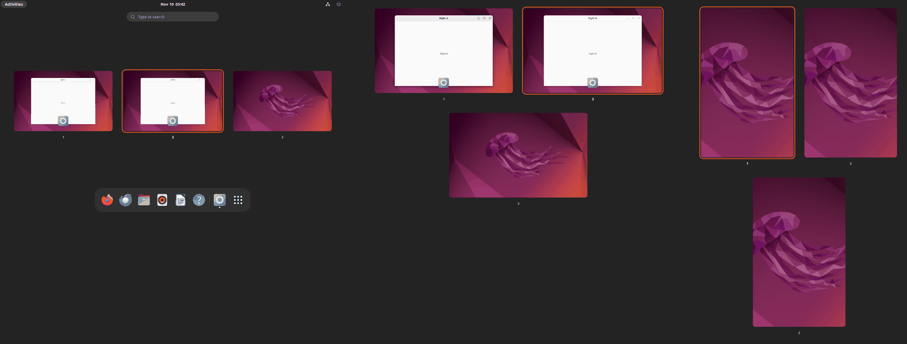
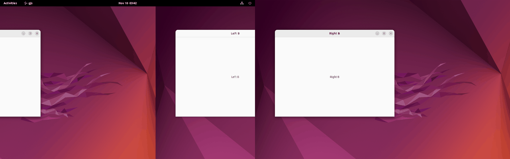

# Monitor Workspaces

A GNOME Shell 42 extension that gives every monitor its own workspace selection.
Switching workspaces on one monitor leaves the other monitors exactly where they
are — no windows moved, no shared transition animation.

GNOME's own "Workspaces on all displays" option switches every monitor together,
and its per-monitor alternatives still activate a global workspace, so all screens
animate. This extension keeps native workspaces as window storage but tracks the
selected workspace per monitor, so a switch only touches the monitor you asked for.



## Requirements

- GNOME Shell 42 (developed and tested on Ubuntu 22.04 with GNOME 42.9, X11)
- Fixed workspaces on all displays. The extension sets both options while it is
  enabled and keeps your existing workspace count.

## Install

From a release archive:

```sh
gnome-extensions install --force monitor-workspaces@local.shell-extension.zip
gnome-extensions enable monitor-workspaces@local
```

From a clone:

```sh
make install
gnome-extensions enable monitor-workspaces@local
```

GNOME must reload before it sees a newly installed extension. On X11 press
**Alt+F2**, type `r`, and press Enter; this keeps your applications open. On
Wayland, log out and back in.

## Use

- **Ctrl+Alt+Left/Right** (and **Ctrl+Alt+A/Q**) switch the monitor under the
  mouse pointer, wrapping at the ends. A small row of dots on that monitor shows
  where you are.
- GNOME's other workspace shortcuts act on the monitor under the pointer too:
  **Super+Home/End** and "switch to workspace *N*" pick that monitor's own
  workspace numbers, whatever the native index behind it.
- "Move window to workspace" shortcuts (for example **Shift+Ctrl+Alt+Right**)
  carry the focused window to the next workspace of *its* monitor and switch that
  monitor along with it.
- **Super+scroll** on the desktop switches the monitor under the pointer, with
  ordinary and high-resolution wheels.
- **Alt+Tab**, notifications, and anything else that activates a window on a
  hidden workspace reveal that workspace on the window's own monitor only.
- **Super** opens the overview with a grid of workspace cards on every monitor,
  each showing that monitor's wallpaper and live window thumbnails with app icons.
  The grid picks the layout that makes the cards largest, so portrait monitors get
  portrait cards. Click a card to select it on that monitor; click the current
  card to close the overview. Click a window to switch to it, hover it for its
  full title, or use its close button.
- Scroll over a monitor's cards to switch that monitor.
- Drag a window thumbnail onto another card to move it, including onto another
  monitor. The destination highlights while hovering; neither monitor switches.
  Press **Escape** to cancel. Dropping a pinned window onto a specific workspace
  removes its "Always on Visible Workspace" state.
- Search and the app grid keep GNOME's normal interfaces. Cards leave room for the
  search field and launcher using their actual on-screen positions, disappear as
  soon as you type a search or open the app grid, and fade out with the overview.
- Each monitor's workspace numbering is remembered across Shell restarts, the
  lock screen, and monitors waking from sleep.

Desktop switches slide left or right over 260 ms, clipped to the selected
monitor's bounds. The panel, dock, and sticky windows stay fixed, desktop icons
slide with the wallpaper behind application windows, and GNOME's
"reduce animations" preference is respected.



## How it works

`src/model.js` holds the pure logic: for each monitor it maps a monitor-local
workspace number onto a native workspace index, and computes the window moves
that make a selection visible. Because the mapping is per monitor, selecting a
workspace only rewrites the workspace membership of windows on that monitor and
never calls `Workspace.activate()`, which is what would drag every monitor along.

`src/animation.js` snapshots the outgoing and incoming contents of the affected
monitor into two actors inside a clipped container and slides them, leaving the
real window actors on other monitors untouched.

`src/overview.js` draws the cards in the overview using GNOME's own background
manager and window-preview layout; `src/overviewLayout.js` and
`src/windowLayout.js` are the pure layout maths for the card grid and the window
thumbnails inside each card. `src/indicator.js` is the per-monitor switch
indicator.

`src/extension.js` routes everything that would switch workspaces through the
model: the workspace shortcuts, Super+scroll, `Main.activateWindow` (Alt+Tab,
notifications), and `actionMoveWorkspace` for other callers. A native switch that
still happens, such as an app raising itself, is absorbed onto the monitor of the
window that took focus, and GNOME's all-monitor slide is suppressed for it. Every
hook is restored on disable. The extension stays enabled on the lock screen
(`session-modes`), because disabling it there would restore "Workspaces on primary
display only" and collect every hidden window on secondary monitors onto the
visible workspace at unlock.

## Development

```sh
make help          # list targets
make test          # syntax, model, animation-stacking, and packaging checks
make build         # deterministic archive in dist/
make integration   # isolated headless GNOME session (needs GNOME 42)
make install       # build and install into the current user profile
```

`make test` runs without a desktop: `tests/model.test.js` covers monitor
isolation, arbitrary jumps, wraparound, sticky windows, attached dialogs, the
native fallback path for three monitors against three physical origins, and
remembering each monitor's selection by geometry; `tests/overview-layout.test.js`
and `tests/window-layout.test.js` cover the card grid and thumbnail layout;
`tests/animation-stacking.test.js` covers the desktop-icon and pinned-window
stacking on both sliding pages; `tests/test_build.py` checks that the archive is
reproducible, contains only runtime files, and ships every source module.

`make integration` builds the extension into a throwaway XDG data home, installs
`tests/driver.js` beside it as a test-only extension, and starts a private
GNOME Shell 42 session (`--headless --wayland`, two 1280×800 monitors and one
800×1280 portrait monitor, a private D-Bus session, the keyfile GSettings backend,
and "Workspaces on primary display only" initially on) with four real GTK windows
from `tests/fixtures.js`. It asserts card selection, independent window placement,
real keyboard input for the arrow, numbered, and move-window shortcuts,
Super+scroll (discrete and smooth), smooth scrolling over cards, Alt+Tab-style and
native window activation, **zero global workspace-switch signals**, lock and
unlock, monitor re-enumeration, monitor-bounded animation with untouched
neighbouring monitors mid-slide, repeated and simultaneous transitions, reduced
motion, search, the app grid, the fade-out, window-preview clicks, the close
button, drag-and-drop, overview cleanup, disable, and re-enable. Results and
screenshots land in the test home, by default `/tmp/monitor-workspaces-test`. Keep
`--home` short: the Wayland socket path inside it must fit in 107 bytes.

`tests/driver.js` is never part of the built archive; do not install it into a
real profile.

## Known limitations

- GNOME 42 only. It has not been ported to the newer extension API.
- Dragging supports open window previews. Dragging launcher icons to create new
  windows on a particular workspace is not implemented. The native window menu
  uses underlying workspace numbers, which may differ from monitor-local numbers.
- Native workspace indicators show the underlying global workspace index. Use the
  cards and the switch indicator for each monitor's real selection.
- Touchpad three- and four-finger workspace swipes are still GNOME's own gesture
  and slide every monitor; the result is then absorbed onto one monitor.
- Extensions that move windows to fixed native workspace numbers (such as Auto
  Move Windows) place them by native index, which may be a hidden workspace.
- Turning the extension off restores "Workspaces on primary display only" if it
  was set; GNOME then shows windows on secondary monitors on every workspace, and
  turning the extension back on gathers them onto the visible one. Locking the
  screen does not do this.
- If a monitor disconnects, mutter moves its windows to the remaining monitors;
  they do not move back by themselves.
- Other extensions that replace the overview or its key handlers, and very large
  workspace counts, need additional integration work.

## Uninstall

```sh
gnome-extensions disable monitor-workspaces@local
gnome-extensions uninstall monitor-workspaces@local
```

Windows stay in ordinary native workspaces and remain accessible afterwards.

## Acknowledgements

This project exists because of
[Switch workspaces on active monitor](https://github.com/micheledaros/gnome-shell-extension-simulate-switching-workspaces-on-active-monitor),
first published by **Xiaoguang Wang (sunwxg)** in 2019 and later carried forward
and published to extensions.gnome.org by **Michele Da Ros**, with contributions
from Jakob Probst, Callum Iddon, and others. It established that per-monitor
workspace switching was worth having on GNOME, and its Ctrl+Alt+Q/A shortcuts are
kept here so it can be swapped in and out without relearning anything.

Their history is grafted into this repository as an ancestor so that credit lives
in `git log`, and their MIT notice is preserved in [LICENSE.upstream](LICENSE.upstream).
No code is shared: this is an independent GNOME 42 implementation with a different
mechanism, as described in the sections above.

## Related work

The upstream extension keeps inactive monitors' contents in place after a global
switch, but cannot avoid the shared animation. V-Shell's overview thumbnails call
native workspace activation directly.
[Workspace Islands](https://github.com/danielbernalo/gnome-workspace-islands)
integrates more deeply but requires a much newer GNOME.

## License

[GPL-2.0-or-later](LICENSE), matching the GNOME Shell ecosystem. The grafted
upstream history remains under its own [MIT license](LICENSE.upstream).
